<p align="center"></p>

<h1 align="center">Zaslon</h1>

<p align="center">A VPN kill switch for AI apps on macOS.<br>
If the VPN is not there, ChatGPT and Claude cannot reach their servers at all, and every other app on your list is frozen.</p>

<p align="center">
  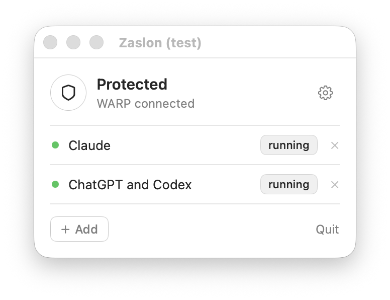
  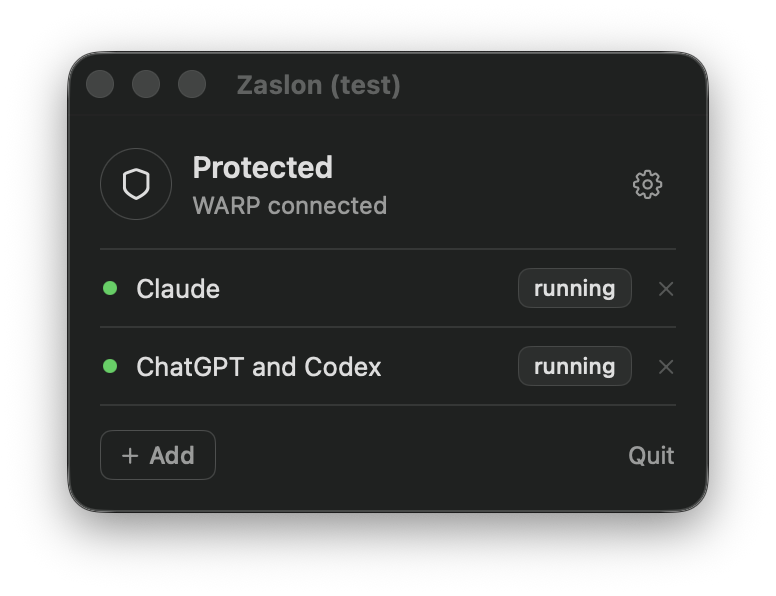
</p>

*Zaslon* (заслон) is Russian for "barrier". It is a small menu bar app, written in Swift and SwiftUI, with no dependencies. It was built for a setup where the VPN must always be on and nothing an AI app sends may leave the Mac outside of it.

> Zaslon works with **Cloudflare WARP** only. The interface comes in English and Russian.

## What it does

| Traffic | How it is protected | Window after a VPN drop |
|---|---|---|
| Servers of **ChatGPT** and **Claude**, from any program on the Mac | The **gate**: the only route to them goes through the VPN tunnel | **None** |
| Everything else an app on your list sends | The **freeze**: the app's whole process tree is stopped | Up to **0.05 s** |
| A program you point at the **tunnel proxy** yourself | Connections are pinned to the tunnel | **None** |
| Apps that are not on the list | Not touched | — |

## How it works

### 1. The gate: ChatGPT and Claude, no window

A kill switch that *reacts* to a drop is always late by the time it takes to notice. The gate does not react. It removes every route to these servers except the one through the tunnel, so there is nothing to be late for.

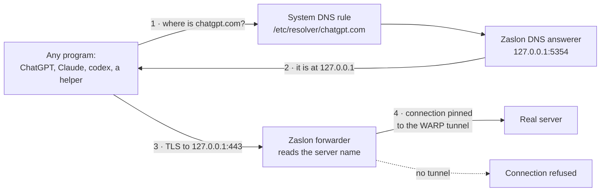

1. **A system DNS rule.** When you add ChatGPT or Claude to the list, Zaslon asks for the admin password once and writes one small file per domain into `/etc/resolver`. From then on, every program's question about these domains goes to Zaslon.
2. **A DNS answerer** on `127.0.0.1:5354` always answers "it is at 127.0.0.1".
3. **A forwarder** on port 443 accepts the program's normal TLS connection, reads the server name from the first packet (SNI), and checks that it is one of the listed services.
4. **A connection pinned to the tunnel.** The forwarder opens the real connection with the tunnel as its *required interface* and passes the bytes both ways. TLS stays end to end. Zaslon decrypts nothing and sees no content.

A connection pinned to the tunnel cannot move to Wi-Fi. When the tunnel is gone, it fails, and so does every new one.

What follows from this design:

- **It covers every program**, not only the app windows: command-line tools (`codex`, `claude`), background agents, and helper processes that ignore proxy settings. They all ask the system for the address, and the system answers 127.0.0.1.
- **No tunnel, no connection.** Zaslon does not even ask DNS for the real address while the tunnel is down.
- **No Zaslon, no connection.** If Zaslon is not running, the DNS question gets no answer. ChatGPT and Claude stop working instead of going around.
- **You stay signed in.** Nothing changes for the apps except the route.

Domains behind the gate:

| App | Domains (with all subdomains) |
|---|---|
| ChatGPT | `chatgpt.com`, `openai.com`, `oaistatic.com`, `oaiusercontent.com` |
| Claude | `anthropic.com`, `claude.ai`, `claude.com`, `claudeusercontent.com` |

### 2. The freeze: every app on the list, up to 0.05 s

Any app can be put on the list. When WARP is not connected, Zaslon sends `SIGSTOP` to the app's whole process tree: the app, its helpers, and everything they started (shells, `git`, MCP servers). A stopped process cannot send anything. When WARP is back, `SIGCONT` lets it continue from where it stopped. Nothing is killed and no work is lost.

How a drop is noticed:

- **A tripwire, 20 times a second.** Zaslon remembers which tunnel interfaces existed while WARP said "Connected" and checks that they are still there. Reading this takes microseconds.
- **`warp-cli status`, twice a second**, and ten times a second during a drop. Only this answer can thaw the apps; the tripwire can only freeze.
- **Unknown means unprotected.** Zaslon freezes the list before the first answer arrives. A missing or hung `warp-cli` keeps it frozen.

**The 0.05 s gap.** The tripwire runs every 50 ms, so for up to 50 ms after a drop a listed app is still running and may send on a connection that is already open. That is the price of reacting. Two more facts, both measured:

- While an app is frozen it sends nothing, but the kernel still *receives* on its open connections (about 25 KB per app in the test).
- ChatGPT's and Claude's own servers are not subject to this gap. They are behind the gate.

Closing the gap for every app would take a system packet filter (a Network Extension), which needs a paid Apple Developer account. Zaslon does not have one.

### 3. The tunnel proxy: for anything you configure yourself

Zaslon also runs an HTTP `CONNECT` proxy on `127.0.0.1:47800`. Every connection it opens is pinned to the tunnel, exactly like the gate's. A program that sends everything through it cannot send anything past the VPN.

```bash
HTTPS_PROXY=http://127.0.0.1:47800 curl https://example.com
```

A Chromium or Electron app takes `--proxy-server=http://127.0.0.1:47800`. With no tunnel the proxy answers `502`; there is no fallback to a direct connection. Plain `http://` requests get `405`.

Not every program obeys proxy settings. In the tests, the ChatGPT app's computer-use helper ignored them completely. That is why the gate works through DNS and not through a proxy.

## The window

Every state, in the light and the dark theme.

| | Light | Dark |
|---|---|---|
| **Protected** |  |  |
| **The VPN is down** | 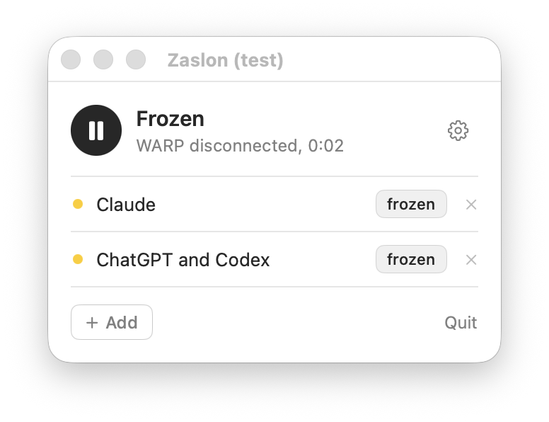 | 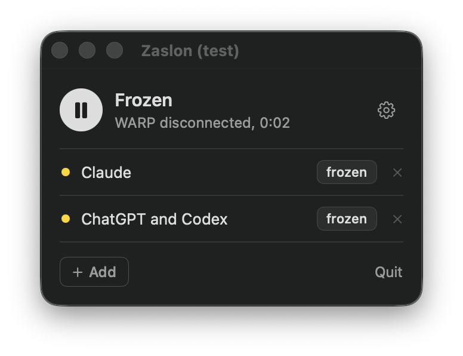 |
| **Protection switched off** | 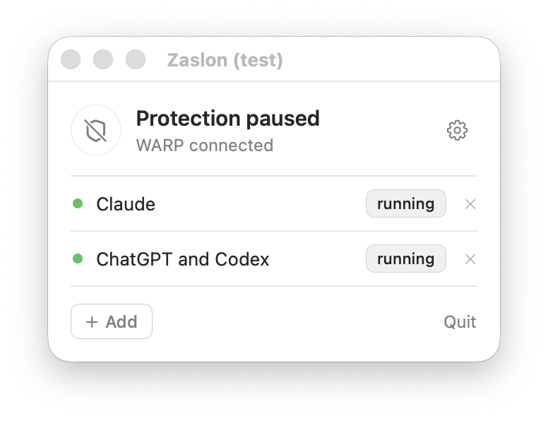 | 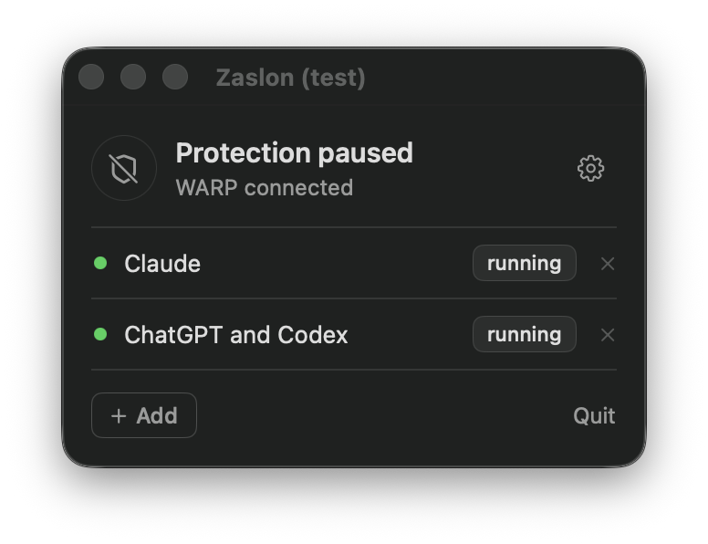 |
| **Settings** | 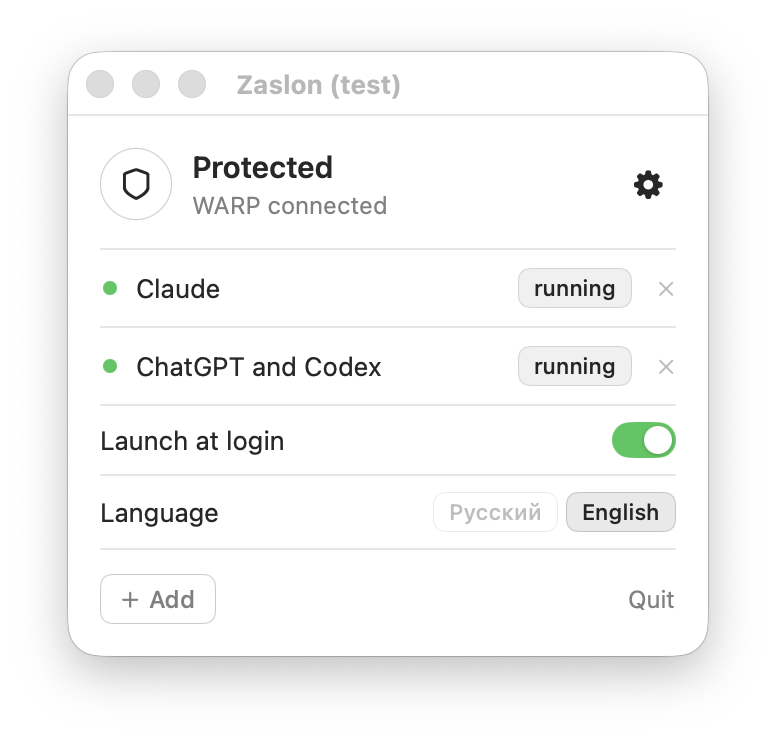 | 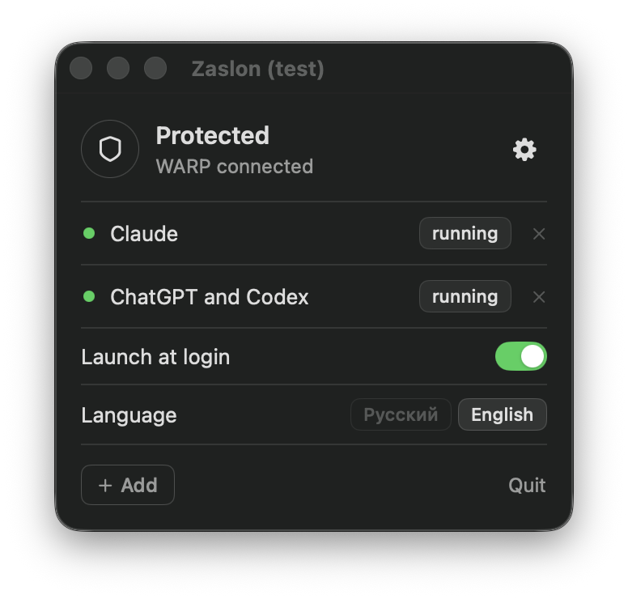 |
| **Adding an app** | 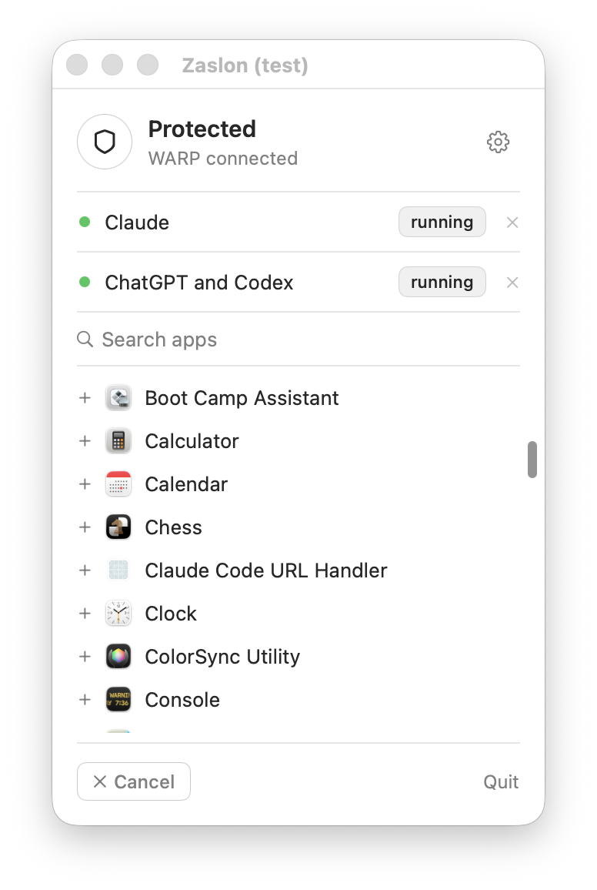 | 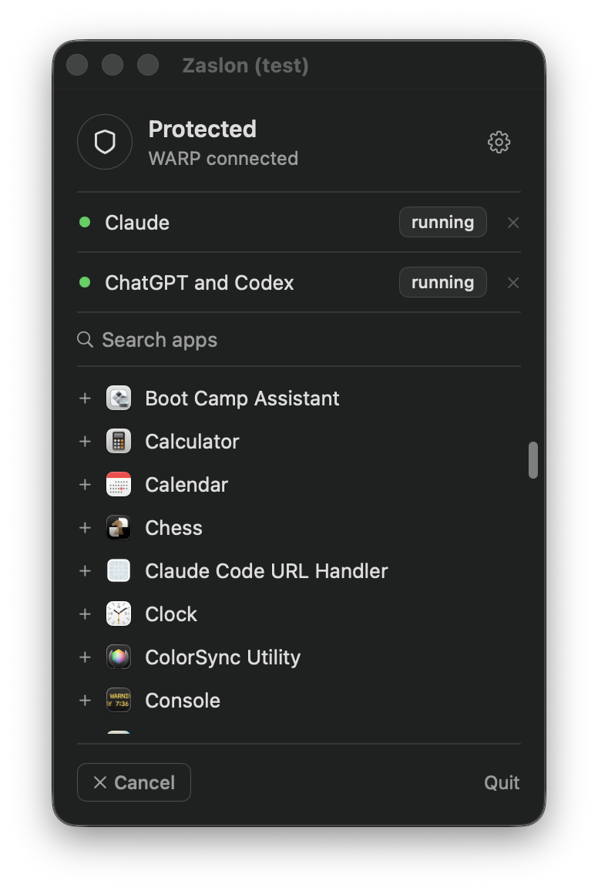 |

The header says what is going on:

| Header | Meaning |
|---|---|
| **Protected** · WARP connected | All is well. |
| **Frozen** · WARP disconnected | The VPN is down and the apps are stopped; the timer shows for how long. |
| **Protection paused** | You switched protection off with the shield button. |
| **Checking** | Asking WARP. The list stays frozen until it answers. |

Each app has one status. It is a measured fact, not a guess from settings: every three seconds Zaslon reads the app's open connections from the kernel.

| Dot | Status | Meaning |
|---|---|---|
| green | **running** | Every connection goes through the VPN. |
| yellow | **outside VPN** | ChatGPT or Claude holds a connection to the internet that does not start from the tunnel. |
| yellow | **frozen** | Stopped: the VPN is down. |
| red | **not working** | ChatGPT or Claude has no gate rule yet. Click the status and enter the admin password. |
| red | **off** | You switched protection off for this app. Click to switch it back on. |
| hollow | **not running** | The app is not open. |

Controls:

- **Shield button**: switches all protection on and off.
- **Status button**: switches protection for that one app.
- **×**: removes the app from the list. For ChatGPT and Claude this also removes the gate rule and asks for the password again.
- **+ Add**: add an app from a searchable list of everything installed. Adding ChatGPT or Claude asks for the admin password; if you refuse, the app is not added.
- **Gear**: settings. **Launch at login**, and **Language**: English or Russian. Zaslon starts in the system's language.
- **Quit**.

## Requirements

- macOS 14 or newer
- [Cloudflare WARP](https://developers.cloudflare.com/warp-client/) with `warp-cli` at `/usr/local/bin/warp-cli`
- The Swift toolchain (Xcode or the Command Line Tools). No Xcode project is needed.

## Build and run

```bash
git clone https://github.com/eruma1ra/zaslon.git
cd zaslon
./build.sh
open build/Zaslon.app
```

`build.sh` compiles a release build, assembles `build/Zaslon.app` and signs it ad hoc. There is no Developer ID and no notarization: build it on the Mac that will run it.

Open the app once after every rebuild. macOS refuses to start the launch agent of a rebuilt app until the app has registered it again, and Zaslon does that on launch.

On first launch Zaslon asks whether to start at login. With autostart on, macOS restarts it if it ever crashes (measured: back in 0.2 s).

## Good to know

- **Keep Zaslon running.** While a gate rule exists, ChatGPT and Claude work only through Zaslon. Quit it and they cannot connect.
- **Restarting Zaslon** makes them unreachable for 2–3 seconds. Nothing leaves outside the VPN during that time.
- **An app that was already running** when its rule was written keeps its old connections until you restart it. They go through the VPN, but not through the gate.
- **A browser with its own secure DNS** (DNS over HTTPS) does not ask the system for addresses, so the gate does not see it. Put the browser on the list to cover it with the freeze.

To remove the gate rules by hand, for example if you deleted Zaslon without removing the apps from its list first:

```bash
sudo sh -c 'for d in chatgpt.com openai.com oaistatic.com oaiusercontent.com anthropic.com claude.ai claude.com claudeusercontent.com; do rm -f /etc/resolver/$d; done; dscacheutil -flushcache; killall -HUP mDNSResponder'
```

## Checking it yourself

Everything runs from the binary inside the bundle, `build/Zaslon.app/Contents/MacOS/Zaslon`.

| Command | What it does |
|---|---|
| `--selftest` | Checks the logic: freeze and thaw on a fake process table, the tripwire, TLS server name parsing, DNS answers, the rule script (in a scratch folder, without admin rights), the connection reader. |
| `--cover <app or name…>` | Read-only. Lists every process an entry would freeze and every connection they hold, marking the ones outside the VPN. |
| `--drill <seconds> <app or name…>` | A fire drill without touching the VPN: freezes the given programs through the real code path, then thaws them. |
| `--gate <port> <dns port> [interface]` | Runs only the gate on spare ports. |
| `--proxy <port> [interface]` | Runs only the tunnel proxy. |
| `--window`, `--picker` | Shows the panel in a normal window. With `SHOT=<file.png>` it saves a picture and quits; `LOOK=light\|dark`, `UI=en\|ru`, `DROP=1`, `OFF=1` and `GEAR=1` choose the state. |

## What was measured

- **Fire drill** on two apps, 68–70 processes: bytes sent while frozen: 0. All processes resumed.
- **The gate with the ChatGPT app.** After a normal launch, the app windows, its `codex` agent and its computer-use helper connected only to `127.0.0.1:443`. No program reached ChatGPT's real addresses directly. The forwarder's outgoing connections left from the tunnel's address.
- **The gate stopped for 30 seconds** (standing in for a drop): no program fell back to a direct connection. When it came back, they reconnected by themselves.
- **Long work through the gate**: Codex code reviews ran through it, and survived a 14-second gap.
- **The connection reader** behind the status matched `lsof` line for line.

**Not tested: a real VPN drop.** The Mac this was built on is not allowed to go without the VPN, so the drop path was checked only by the stand-ins above.

## Limits

- Cloudflare WARP only. Another VPN needs its own "is it connected" check.
- The freeze has a window of up to 50 ms, and the kernel keeps receiving on open connections.
- The gate knows two services, at fixed paths: `/Applications/ChatGPT.app` and `/Applications/Claude.app`. The list is in `Gate.swift`.
- One address per name, IPv4 only. The DNS answerer gives no IPv6 answer, so programs use IPv4.
- A real per-app firewall is out of reach without a Network Extension.

## Source

| File | What is in it |
|---|---|
| `Sources/Zaslon/Guard.swift` | The freeze: process scan, process trees, WARP check, tripwire, self-test. |
| `Sources/Zaslon/Gate.swift` | The gate: DNS answerer, forwarder, the `/etc/resolver` rule, the connection reader. |
| `Sources/Zaslon/Proxy.swift` | Tunnel-pinned connections, the real-address lookup, the `CONNECT` proxy. |
| `Sources/Zaslon/App.swift` | The menu bar window, autostart, test windows. |
| `build.sh`, `icon.swift` | Builds the app bundle; draws the icon. |

## Credits

The idea of a per-app kill switch that freezes apps comes from [Kordon](https://kordon.tech). Zaslon is an independent implementation; the gate and the tunnel proxy are its own.

## Author

Elimir Tilindis

## License

[MIT](LICENSE)
